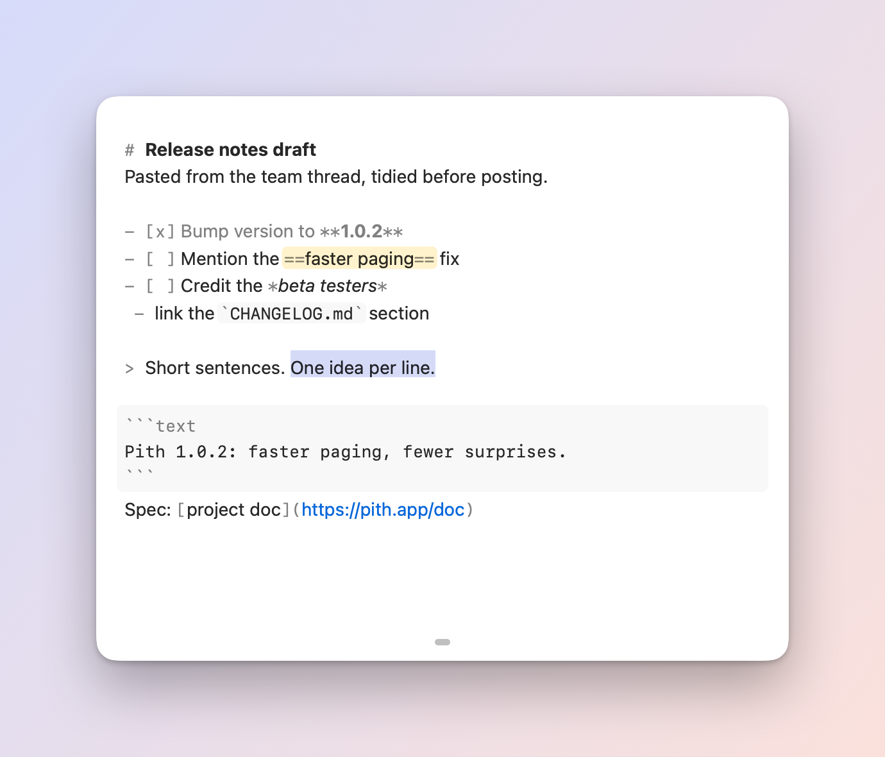
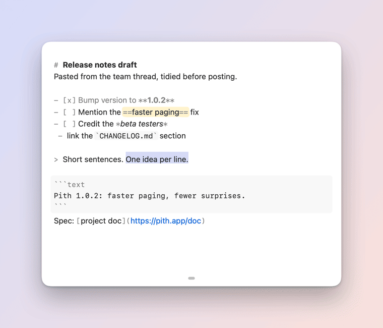

# Pith

[](https://github.com/itigancov/pith/actions/workflows/test.yml)
[](https://github.com/itigancov/pith/releases/latest)
[](LICENSE)

A live-Markdown note editor for macOS, built on NSTextView and TextKit 2.

**Status:** early, a prototype. What changed in each release is in the [changelog](CHANGELOG.md).

<p align="center">
  <picture>
    <source media="(prefers-color-scheme: dark)" srcset="docs/images/panel-dark.png">
    
  </picture>
</p>

## Features

- **Hotkey** — ⌥Space opens and hides the panel from any app, without taking focus away from it. The panel stays over other apps until you hide it.
- **Live Markdown** — the text stays plain Markdown, styled as you type.
- **Stack** — notes in one stack: ⌘N for a new one, swipe or ⇧⌘[ / ⇧⌘] to page, ⌘1 for the latest.
- **Search** — ⌘F across all notes, with highlighted snippets.
- **Trash** — ⌘⌫ moves a note there, with an undo toast.
- **Open at login** — so the Hotkey works right after you sign in.

<p align="center">
  <picture>
    <source media="(prefers-color-scheme: dark)" srcset="docs/images/demo-dark.gif">
    
  </picture>
</p>

## Requirements

- macOS 14 (Sonoma) or later, Apple silicon or Intel

## Install

Pith is ad-hoc signed and not notarized (there is no Developer ID), so macOS blocks a downloaded copy until you allow it. Homebrew does that for you.

### Homebrew

```sh
brew install --cask itigancov/tap/pith
```

Update with `brew upgrade --cask pith`. Remove with `brew uninstall --cask pith`; add `--zap` to delete the notes and settings too.

### Manual

1. Download `Pith-<version>.zip` from [Releases](https://github.com/itigancov/pith/releases) and unzip it.
2. Move `Pith.app` to `/Applications`. Started from elsewhere, Pith offers to move itself there (“Move Pith to Applications?”).
3. Open it. macOS refuses, because the app is not notarized.
4. Open **System Settings → Privacy & Security**, scroll down to the message about Pith and click **Open Anyway**, then confirm.

## Development

To build: Xcode 27 and [`xcodegen`](https://github.com/yonaskolb/XcodeGen).

- `make test` — run the package tests
- `make build` — generate the Xcode project and build `Pith.app`
- `make run` — build and open `Pith.app` (`FIXTURE=<path>` for another text)
- `make bench` — timings against the budgets
- `make release VERSION=X.Y.Z` — publish a release, see [`scripts/release.sh`](scripts/release.sh)

## License

[MIT](LICENSE)
